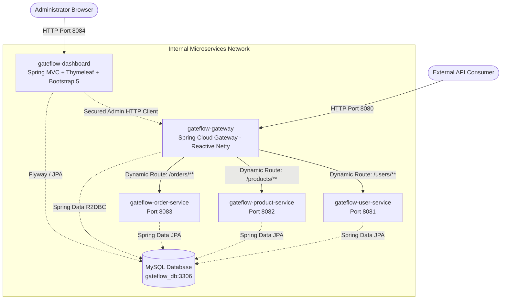
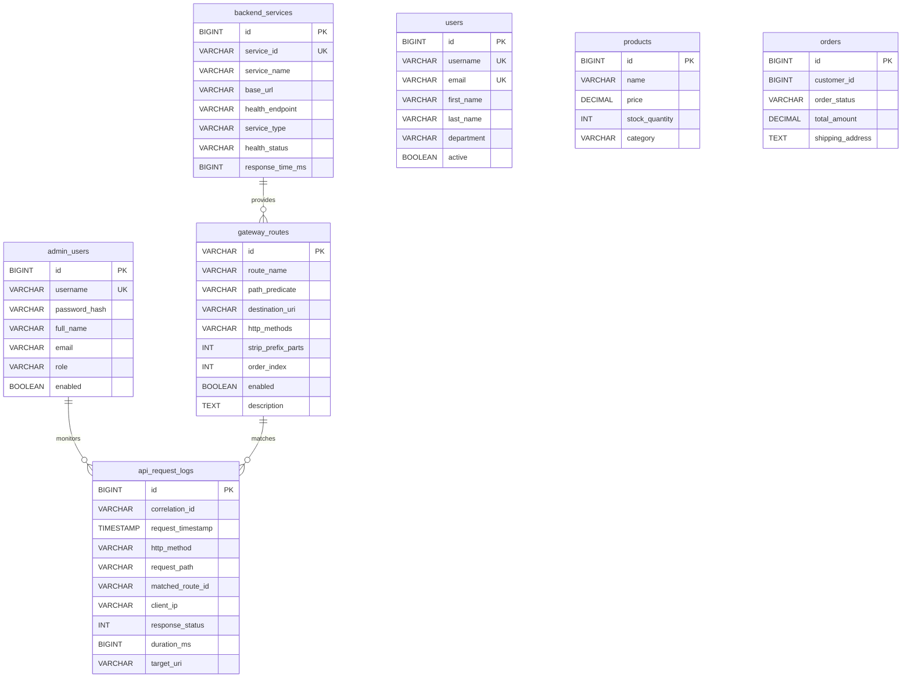

# GateFlow — API Gateway with Dynamic Routing

> **College Case Study Project: Distributed Systems & Cloud Microservice Architecture**  
> **Author & Architect**: Antigravity Full-Stack Engineering  
> **Stack**: Java 21 LTS | Spring Boot 3.3.4 | Spring Cloud Gateway (WebFlux / Netty) | Spring Data R2DBC | Spring MVC | Spring Data JPA | Thymeleaf | Bootstrap 5 | MySQL 8.0 & MySQL Workbench

---

## 1. Project Abstract
**GateFlow** is an enterprise-grade API Gateway with genuine runtime dynamic routing capabilities, accompanied by a reactive non-blocking reverse proxy and a decoupled Spring MVC/Thymeleaf administrative dashboard. In traditional static API gateways, any modification to routing rules (e.g. adding microservices, re-routing paths, canary testing) requires redeployment or server restarts, causing downtime. **GateFlow** solves this challenge by persisting route configurations in MySQL and synchronizing runtime route definitions on the fly using reactive event-driven route refresh mechanisms in Spring Cloud Gateway.

---

## 2. Problem Statement & Motivation
Modern cloud systems operate across dozens to hundreds of microservices. Traditional API Gateways configure routes statically via `application.yml` or static Java beans:
1. **Downtime & Redeployment**: Adding or updating an API route requires restarting the gateway instance.
2. **Configuration Drift**: Configuration files across clusters quickly become inconsistent.
3. **No Central Observability**: Operators lack a centralized control plane to view active traffic, test live endpoints, and audit latency.
4. **Thread Exhaustion**: Legacy blocking architectures (e.g. Zuul 1 / standard Spring MVC gateways) consume one thread per HTTP request, failing under high concurrency.

**GateFlow** addresses these problems by implementing a non-blocking reactive API Gateway on Netty, backed by reactive MySQL persistence (R2DBC) and event-driven route refresh listeners.

---

## 3. Architecture & Microservices Topology



### Architectural Separation
| Module | Port | Architecture | Technology Stack | Key Responsibilities |
| :--- | :---: | :--- | :--- | :--- |
| `gateflow-gateway` | **8080** | Reactive Non-Blocking | Spring Cloud Gateway, WebFlux, R2DBC | Reverse proxy, dynamic route definition repository, runtime event broadcaster, audit logging filter |
| `gateflow-dashboard` | **8084** | Multi-Page App (MVC) | Spring MVC, Thymeleaf, Bootstrap 5 | Admin login, visual route manager, live API workbench/tester, service health checks, logs |
| `gateflow-user-service` | **8081** | REST Microservice | Spring MVC, JPA, MySQL Connector/J | User management domain CRUD REST APIs |
| `gateflow-product-service` | **8082** | REST Microservice | Spring MVC, JPA, MySQL Connector/J | Product catalog domain CRUD REST APIs |
| `gateflow-order-service` | **8083** | REST Microservice | Spring MVC, JPA, MySQL Connector/J | Order processing domain CRUD REST APIs |

---

## 4. How Genuine Dynamic Routing Works

In Spring Cloud Gateway, routes are typically loaded from `RouteDefinitionLocator` beans. GateFlow implements:

1. **`DatabaseRouteDefinitionRepository implements RouteDefinitionRepository`**:
   - Queries `gateway_routes` in MySQL via reactive R2DBC (`GatewayRouteRepository.findAllByEnabledTrue()`).
   - Converts each database record into a Spring Cloud Gateway `RouteDefinition` with:
     - `PathPredicate` (e.g. `/users/**`)
     - `MethodPredicate` (e.g. `GET,POST,PUT,DELETE,PATCH`)
     - `FilterDefinition` (`StripPrefix` if specified)
     - Target `URI` (`http://localhost:8081`)
2. **`RouteRefreshService`**:
   - When an administrator adds, edits, toggles, or deletes a route in the dashboard, the gateway commits the change to MySQL.
   - Upon successful database commit, the gateway fires `ApplicationEventPublisher.publishEvent(new RefreshRoutesEvent(this))`.
   - Spring Cloud Gateway listens to this event, calls `getRouteDefinitions()`, recomputes its internal routing graph, and activates the new routing rules in memory **without dropping incoming Netty connections or restarting the JVM**.
3. **Consistency & Error Reconciliation**:
   - If a route definition fails validation (e.g. illegal URI scheme, reserved path conflict), the gateway returns an HTTP 400 Bad Request error and rejects persistence.

---

## 5. Database Schema & Flyway Migrations

The database is named `gateflow_db` and contains 7 normalized tables:



### Inspecting Database via MySQL Workbench
1. Launch **MySQL Workbench 8.0 CE**.
2. Connect to local instance: `Host: 127.0.0.1`, `Port: 3306`, `User: root`, `Password: root`.
3. In the SQL Editor, execute:
   ```sql
   USE gateflow_db;
   SELECT * FROM gateway_routes;
   SELECT * FROM api_request_logs ORDER BY request_timestamp DESC;
   SELECT * FROM users;
   SELECT * FROM products;
   SELECT * FROM orders;
   ```

---

## 6. Execution Instructions (Windows & PowerShell)

### Prerequisites Check
Run the following in Windows PowerShell:
```powershell
java -version
mvn -version
```

### Launching All Services in 1-Click
A PowerShell orchestrator script is included in the project root:
```powershell
cd "d:\API Gateway with Dynamic Routing java"
.\start-gateflow.ps1
```
This script checks MySQL, starts all 5 microservices in separate terminals, and opens the dashboard in your default browser at `http://localhost:8084/login`.

### Starting Services Manually (Individual Terminals)
```powershell
# Terminal 1: API Gateway (Port 8080)
.\mvnw.cmd spring-boot:run -pl gateflow-gateway

# Terminal 2: User Service (Port 8081)
.\mvnw.cmd spring-boot:run -pl gateflow-user-service

# Terminal 3: Product Service (Port 8082)
.\mvnw.cmd spring-boot:run -pl gateflow-product-service

# Terminal 4: Order Service (Port 8083)
.\mvnw.cmd spring-boot:run -pl gateflow-order-service

# Terminal 5: Dashboard Portal (Port 8084)
.\mvnw.cmd spring-boot:run -pl gateflow-dashboard
```

---

## 7. Verification & Live API Testing

Default Admin Credentials:
- **URL**: [http://localhost:8084/login](http://localhost:8084/login)
- **Username**: `admin`
- **Password**: `admin123`

### Dispatching Requests Through the API Gateway (Port 8080)
```powershell
# 1. Fetch Users via Gateway (routes to Port 8081)
curl.exe -X GET http://localhost:8080/users

# 2. Fetch Products via Gateway (routes to Port 8082)
curl.exe -X GET http://localhost:8080/products

# 3. Fetch Orders via Gateway (routes to Port 8083)
curl.exe -X GET http://localhost:8080/orders

# 4. Create User via Gateway
curl.exe -X POST http://localhost:8080/users `
  -H "Content-Type: application/json" `
  -d '{"username":"kevin_mitnick","email":"kevin@security.net","firstName":"Kevin","lastName":"Mitnick","department":"SecOps","active":true}'

# 5. Check Gateway Dashboard Metrics via Gateway Admin API
curl.exe -X GET http://localhost:8080/api/admin/stats
```

---

## 8. College Case Study Viva Questions & Answers

**Q1: What is the fundamental difference between static routing and genuine runtime dynamic routing?**  
> *Answer*: Static routing defines predicates and URIs in immutable files (like `application.yml` or static Java `@Bean` declarations). Modifying a static route requires compiling, repackaging, and restarting the application, causing service downtime. Genuine runtime dynamic routing stores route definitions in persistent storage (MySQL) and loads them via a reactive `RouteDefinitionRepository`. When routes change, the application publishes a `RefreshRoutesEvent` which causes Spring Cloud Gateway to recompute active routes in memory instantly without restarting the server.

**Q2: Why must Spring Cloud Gateway NOT include Spring MVC or blocking JPA dependencies?**  
> *Answer*: Spring Cloud Gateway is built on Project Reactor, Netty, and Spring WebFlux. It relies on a small pool of non-blocking event-loop threads (typically matching the number of CPU cores). If blocking libraries like Spring MVC or standard JDBC/JPA are placed in the gateway, blocking I/O calls freeze the Netty event loops, causing the entire gateway to stop accepting connections for all clients. GateFlow uses Spring Data R2DBC with an asynchronous MySQL driver to ensure completely non-blocking reactive persistence.

**Q3: How does GateFlow guarantee that request audit logging does not slow down API traffic?**  
> *Answer*: GateFlow implements `RequestLoggingGlobalFilter`, which extends `GlobalFilter` and implements `Ordered` set to `LOWEST_PRECEDENCE`. The logging filter records request metadata and triggers an asynchronous `.subscribe()` write to MySQL through Spring Data R2DBC within the response completion callback, ensuring that logging runs off the critical response latency path.

**Q4: How does the Dashboard interact with the Gateway without compromising reactive architecture?**  
> *Answer*: The dashboard is an isolated Spring MVC application on port 8084. It interacts with the gateway strictly via secured HTTP REST APIs (`/api/admin/...`). It does not share database connections with the gateway's event loop or manipulate gateway memory directly, maintaining clean microservice isolation.

---

## 9. Conclusion
The **GateFlow** college case study project demonstrates an enterprise-grade distributed API architecture combining high-performance non-blocking reactive routing, runtime route definition lifecycle management, secure Spring Security authentication, Spring Data JPA business microservices, and a polished Thymeleaf/Bootstrap 5 administration portal.
