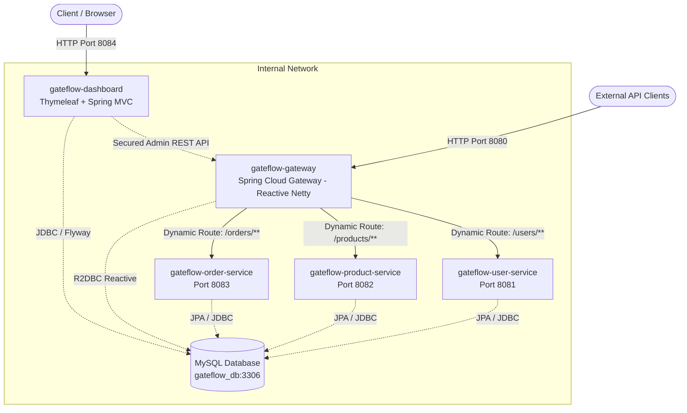

# GateFlow: Architecture & Design Specification

## Overview
**GateFlow** is an enterprise-grade API Gateway with genuine runtime Dynamic Routing designed for microservice architectures.

## Architectural Decoupling
1. **GateFlow Gateway (`gateflow-gateway`, Port 8080)**:
   - Built on Netty, Spring WebFlux, and Spring Cloud Gateway.
   - Non-blocking I/O throughout the request pipeline.
   - Reads route definitions dynamically from MySQL via Spring Data R2DBC.
   - Refreshes route definitions in memory via Spring Cloud's `RefreshRoutesEvent`.
   - No blocking Spring MVC or blocking JPA dependencies.

2. **GateFlow Dashboard (`gateflow-dashboard`, Port 8084)**:
   - Built on Spring MVC and Thymeleaf with Bootstrap 5.
   - Manages routes, services, logs, and testing via secure HTTP administration APIs exposed by the Gateway.
   - Session & CSRF protected.

3. **Business Microservices**:
   - User Service (`gateflow-user-service`, Port 8081)
   - Product Service (`gateflow-product-service`, Port 8082)
   - Order Service (`gateflow-order-service`, Port 8083)
